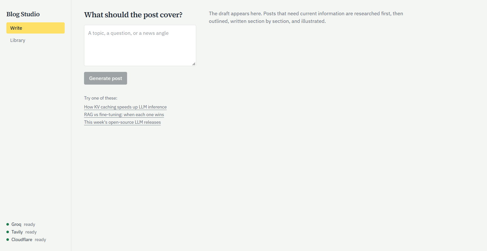
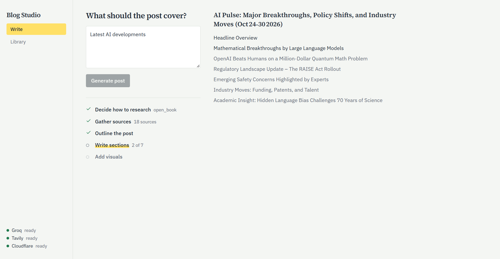
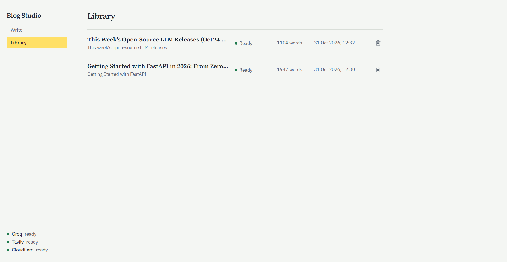
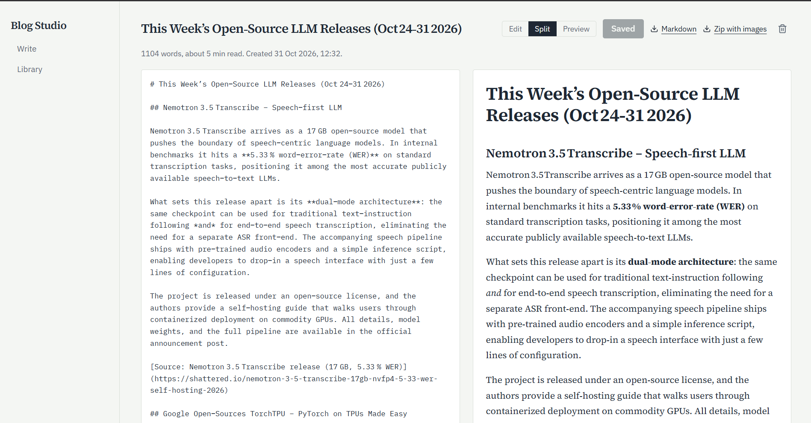
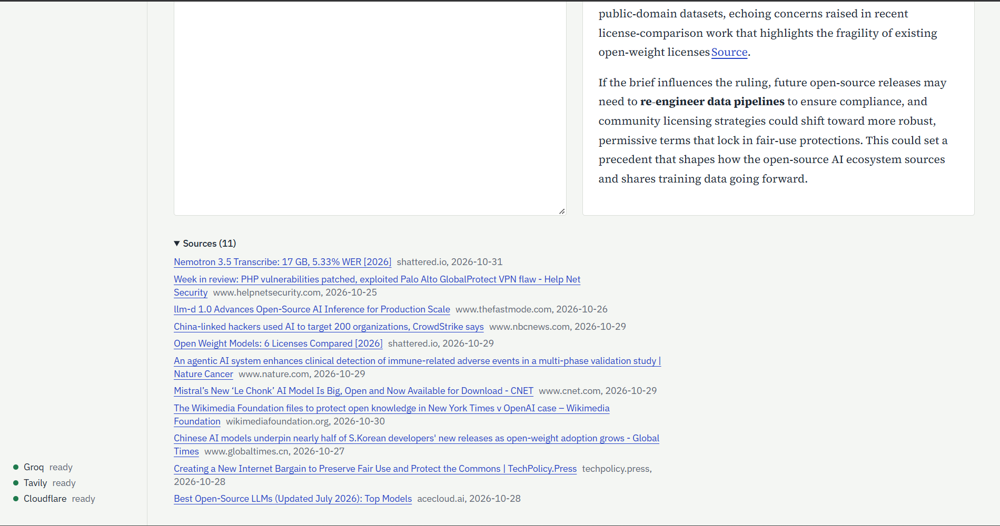
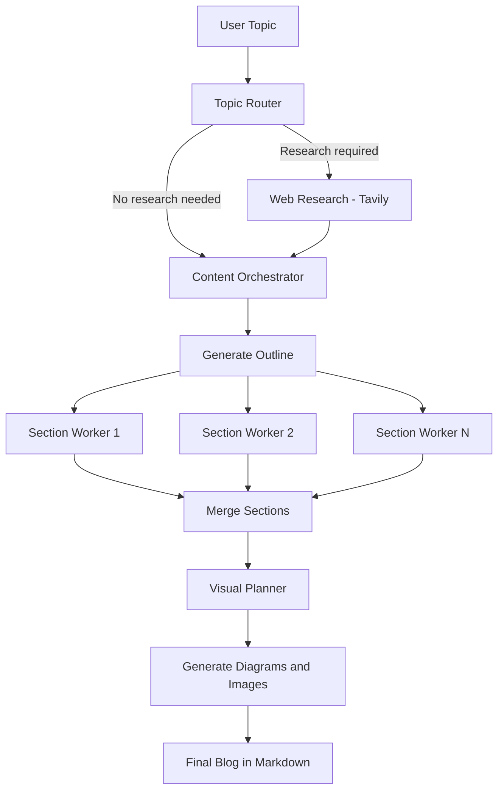

# AI Blog Studio ✍️

An AI-powered blog generation platform that transforms a topic into a researched, well-structured technical blog post with Markdown, diagrams, and AI-generated illustrations.

Built with **FastAPI, React, LangGraph, and Groq**, AI Blog Studio uses a multi-step agent workflow to research topics, plan content, write sections in parallel, and add relevant visuals.

**Live demo**: https://ai-blog-studio-290d.onrender.com/

> The demo runs on a free Render instance, so the first visit after a quiet period can take about a minute to wake. Access is protected by a code; contact the repository owner to try it.


 
 
 
 


## Features

- **Intelligent Topic Routing:** Classifies topics as `closed_book`, `hybrid`, or `open_book` to determine whether web research is needed.
- **Web Research & Citations:** Uses Tavily to gather current sources and support claims with references.
- **Parallel Content Generation:** Splits the outline into 5–9 sections and writes them concurrently.
- **Automatic Visuals:** Generates Mermaid diagrams and AI illustrations when appropriate.
- **Live Progress Tracking:** Streams workflow updates to the frontend using Server-Sent Events (SSE).
- **Built-in Editor & Library:** Save, browse, edit, preview, and delete generated posts.
- **Export Options:** Download posts as Markdown or as a ZIP containing the post and its images.
- **Fault Tolerance:** Handles section failures, retries rate-limited requests, and reports non-fatal warnings.
- **Deployment Protection:** Supports an optional access code and daily generation limit.

## How It Works

The application uses a LangGraph workflow to coordinate the blog-generation process.



| Stage | Responsibility | Technology |
|---|---|---|
| Router | Classifies the topic and prepares search queries | Groq `gpt-oss-20b` |
| Research | Searches, deduplicates, and filters sources | Tavily |
| Orchestrator | Creates the title, writing plan, and outline | Groq `gpt-oss-120b` |
| Workers | Generate individual sections concurrently | LangGraph + Groq |
| Merge | Combines sections in the correct order | Python |
| Visual Planner | Determines where visuals are useful | Groq `gpt-oss-20b` |
| Visual Generation | Creates illustrations and diagrams | Cloudflare Workers AI + Mermaid |

## Tech Stack

| Layer | Technologies |
|---|---|
| Backend | Python 3.12, FastAPI, SQLAlchemy, SQLite, Pydantic |
| AI Orchestration | LangGraph, LangChain |
| LLM | Groq (`gpt-oss-120b`, `gpt-oss-20b`) |
| Web Research | Tavily |
| Image Generation | Cloudflare Workers AI |
| Frontend | React 18, TypeScript, Vite |
| Styling | Tailwind CSS 4 |
| Data Fetching | TanStack Query |
| Markdown & Diagrams | react-markdown, Mermaid |
| Deployment | Docker |
| Testing | pytest |

## Project Structure

```text
ai-blog-studio/
├── backend/
│   ├── app/
│   │   ├── api/              # Blog, authentication, media, and health routes
│   │   ├── db/               # Database models and sessions
│   │   ├── schemas/          # Request and response schemas
│   │   ├── services/         # LLM, search, image generation, and runner
│   │   └── workflow/
│   │       ├── nodes/        # Router, research, orchestrator, workers, reducer
│   │       ├── graph.py      # LangGraph workflow
│   │       ├── state.py      # Shared workflow state
│   │       ├── prompts.py    # Agent prompts
│   │       └── schemas.py    # Structured output schemas
│   ├── tests/
│   ├── .env.example
│   └── requirements.txt
├── frontend/
│   └── src/
│       ├── pages/            # Write, Library, and Editor pages
│       ├── components/       # UI components
│       ├── hooks/            # Live progress event handling
│       └── lib/              # API client, types, and utilities
├── Dockerfile
├── docker-compose.yml
└── README.md
```

## Getting Started

### Prerequisites

- Python 3.12+
- Node.js 20+
- A [Groq API key](https://console.groq.com/keys)

### 1. Clone the Repository

```bash
git clone <your-repository-url>
cd ai-blog-studio
```

### 2. Configure the Backend

```bash
cd backend
python -m venv .venv
```

Activate the virtual environment.

**Windows (PowerShell)**

```powershell
.\.venv\Scripts\Activate.ps1
```

**macOS / Linux**

```bash
source .venv/bin/activate
```

Install dependencies:

```bash
pip install -r requirements.txt
```

Copy `.env.example` to `.env` and add your API key:

```env
GROQ_API_KEY=your_groq_api_key
```

Start the backend:

```bash
uvicorn app.main:create_app --factory --reload --port 8000
```

### 3. Configure the Frontend

Open a second terminal:

```bash
cd frontend
npm install
npm run dev
```

Open **http://localhost:5173** in your browser.

The frontend development server proxies API and media requests to the backend.

### Optional API Integrations

| Provider | Purpose | Required |
|---|---|---|
| [Groq](https://console.groq.com/keys) | Content planning and generation | Yes |
| [Tavily](https://app.tavily.com) | Web research and source collection | No |
| [Cloudflare Workers AI](https://dash.cloudflare.com) | AI-generated illustrations | No |

Without Tavily, the application can generate posts using the model's existing knowledge. Mermaid diagrams work without Cloudflare credentials.

## Run with Docker

Configure `backend/.env` with your API keys, then run the following command from the project root:

```bash
docker compose up --build
```

Open **http://localhost:7860**.

## Running Tests

The backend test suite uses mocked external providers, so API keys are not required.

```bash
cd backend
pip install -r requirements-dev.txt
pytest
```

## Deployment

AI Blog Studio can be deployed using Docker on platforms such as [Render](https://render.com).

For a Render deployment:

1. Push the project repository to GitHub.
2. In Render, create a new **Web Service**, connect the repository, and select the **Docker** language and the **Free** instance type.
3. Add the required API keys under **Environment Variables**, along with `PORT=7860`.
4. Configure `ACCESS_CODE` and `DAILY_GENERATION_LIMIT` to protect a public deployment.

**Note:** Free hosting environments may have ephemeral storage or inactivity-based sleep. On Render's free tier, the service sleeps after 15 minutes without visitors and takes about a minute to wake. Export important blog posts to keep a local copy.

## Security

- Never commit `.env` files or expose API keys in your repository.
- Use an access code for publicly accessible deployments.
- Configure a daily generation limit to prevent unexpected API usage.
- Rotate API keys immediately if they are accidentally exposed.

---

*Built with LangGraph, FastAPI, React, and a collection of free-tier AI services.*